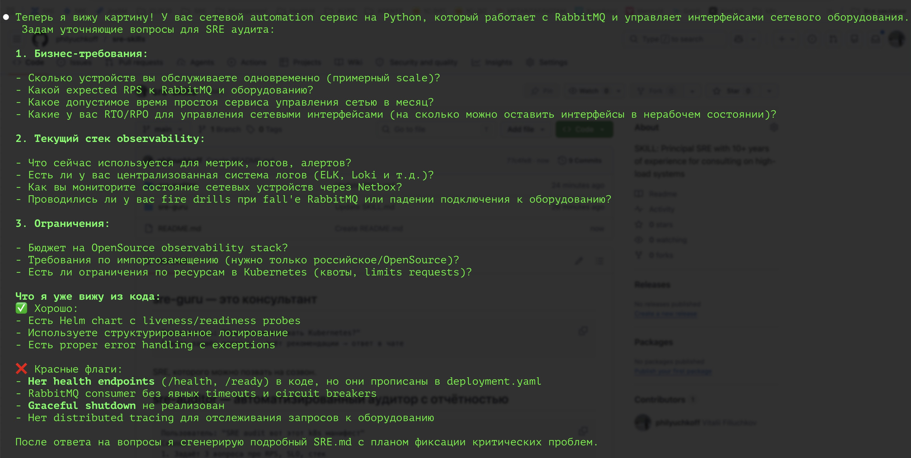

# SRE Architect

Стратегическое проектирование надёжности: архитектура observability, алертинг, инциденты, PRR, chaos, oncall. Только self-hosted OpenSource, работа в РФ.

```
Пользователь: "Проведи production readiness review для payment-api"
Скилл: контекст → чек-лист PRR → вердикт «готов с условиями» → риски с владельцами → план
```

## Что делает

| Режим | Запрос | Результат |
|-------|--------|-----------|
| Консультация | «Как спроектировать observability» | Решение с trade-offs |
| PRR | «Проведи PRR» | Вердикт и список действий |
| Дизайн | «Спроектируй мониторинг для 20 сервисов» | Схема сбора и инструменты |
| Риски | «Найди слабые места» | Реестр рисков с владельцами |

## Структура

```
sre-architect/
├── SKILL.md                          процесс, режимы, формат ответа
└── references/
    ├── prr-checklist.md              чек-лист PRR и критерии вердикта
    ├── alerting.md                   severity, burn rate, Alertmanager + Telegram
    ├── incident-response.md          роли, жизненный цикл, эскалация, postmortem
    ├── chaos.md                      программа экспериментов, Chaos Mesh, Litmus
    ├── oncall.md                     ротация, handoff, Keep, шаблон runbook
    ├── risk-matrix.md                матрица рисков и приоритеты
    └── tooling.md                    стек, лицензии, схема сбора данных
```

Справочники подгружаются по `focus_area`: спрашивать про алерты — читается `alerting.md`, про PRR — `prr-checklist.md`.

## Быстрый старт

```bash
# в чате
"Проведи PRR для payment-api"
"Спроектируй observability для 20 микросервисов, только OpenSource"
"Найди слабые места: user-auth зависит от payment-api и БД"
"Спланируй chaos-программу на квартал"
"Чем заменить Opsgenie в РФ?"
```

## Стек

| Категория | Инструменты |
|-----------|-------------|
| Метрики | VictoriaMetrics, Prometheus, Thanos |
| Логи | Loki, Elasticsearch + Kibana |
| Трейсы | Jaeger, Tempo |
| Сбор | OpenTelemetry Collector |
| Дашборды | Grafana |
| Алерты | Alertmanager, Keep |
| Chaos | Chaos Mesh, Litmus |
| Связь | Telegram, Mattermost |

Подробнее, с лицензиями и критериями выбора — `references/tooling.md`.

## Чего не делает

- Тактические правки кода и конфигов — это `sre-guru` и `sre-auditor`.
- Аудит безопасности и комплаенс.
- Коммерческие SaaS не предлагает, даже с бесплатным тарифом.
- Не выдаёт гипотезу за факт: если данных нет, так и пишет.

## Связанные скиллы

| Скилл | Когда использовать |
|-------|--------------------|
| [`sre-guru`](../sre-guru/README.md) | Тактический разбор конкретной проблемы |
| [`sre-auditor`](../sre-auditor/README.md) | Аудит кода и конфигов, отчёт `SRE.md` |
| [`sre-slx`](../sre-slx/README.md) | SLO/SLI, error budget, burn rate |


