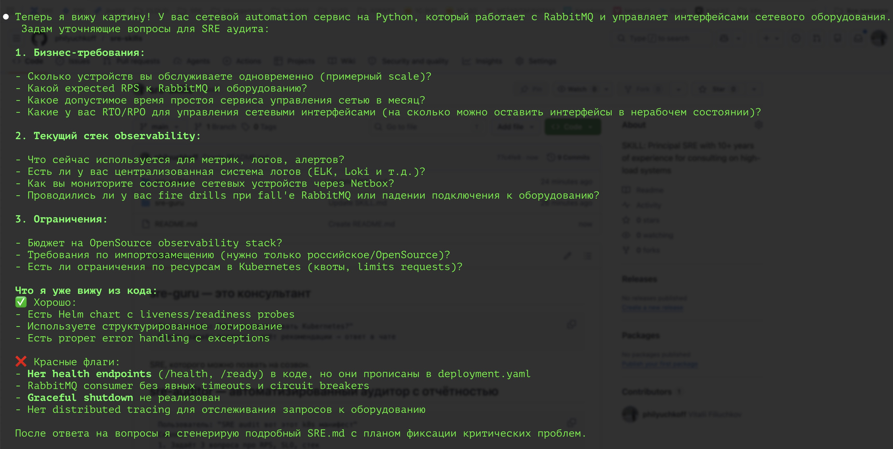

## sre-auditor — SRE аудитор с отчётностью

```
Пользователь: "Проведи SRE audit вот этого k8s манифеста"
```

```
Скилл:
1. Спрашивает только недостающее (максимум 3 вопроса: нагрузка, стек, ограничения)
2. Собирает факты скриптом: probes, PDB, лимиты, CI, бэкапы
3. Находит проблемы и подтверждает каждую ссылкой файл:строка
4. Классифицирует: 🔴 Critical (24-72 часа) … ⚪ Low (бэклог)
5. Показывает отчёт в чате
6. После подтверждения пишет SRE.md в корень проекта
```

SRE, который оставляет **письменный аудит** и требует исправлений.

1. Генерирует файл `SRE.md`, чтобы следы аудита остались в директории. Файл пишется только после подтверждения — репозиторий не засоряется без спроса.
2. Приоритеты с дедлайнами и проверяемыми признаками (`references/severity.md`), а не на глаз: бизнес понимает, что горит.
3. Не использует в рекомендациях платные сервисы и managed-обёртки OpenSource (Grafana Cloud, Elastic Cloud) — только self-hosted, юридически безопасно для РФ.
4. Каждая находка имеет доказательство: файл, строку и цитату. Отчёт можно проверить, а не только поверить ему.
5. Повторный аудит не затирает историю: статусы находок (`исправлено` / `открыто` / `новое`) и журнал прогонов с git-коммитом.
6. Указывает «слабое место аудита» — что не проверено и почему.

## Структура

```
sre-auditor/
├── SKILL.md                        процесс: режимы, параметры, правила, критерии готовности
├── references/
│   ├── sre-md-template.md          шаблон отчёта (грузится при генерации SRE.md)
│   ├── severity.md                 критерии приоритетов и рубрика оценок 0-5
│   ├── checklists.md               чек-листы по слоям с указанием, где искать доказательство
│   └── oss-stack.md                self-hosted стек: VictoriaMetrics, Loki, Tempo, Alertmanager
└── scripts/
    └── collect-facts.sh            сбор фактов по репозиторию перед выводами
```

## Быстрый старт

```bash
# собрать факты по проекту (markdown в stdout, ничего не меняет)
bash scripts/collect-facts.sh /путь/к/проекту
```

## Сравнение

Разница с `sre-guru`, как между **«давай я расскажу»** и **«вот отчёт, исправляй Critical за 24 часа»**. Полная таблица всех четырёх скиллов — в [корневом README](../README.md).

| Характеристика | `sre-guru` | `sre-auditor` |
|----------------|------------|---------------|
| **Основная роль** | Эксперт, отвечающий на вопросы | Инструмент аудита с генерацией артефактов |
| **Режим работы** | Только консультативный | Консультативный + **аудиторский** |
| **Обязательный вывод** | Текстовый ответ в чате | Отчёт в чате, `SRE.md` после подтверждения |
| **Доказательства** | Нет | `файл:строка` + цитата для каждой находки |
| **Приоритеты** | Неявные | 🔴 Critical / 🟡 High / 🔵 Medium / ⚪ Low с признаками |
| **Повторный аудит** | — | Обновление статусов + журнал с git-коммитом |
| **Checklist'ы** | Нет | Код, инфраструктура, observability, CI/CD, DR, документация |
| **Слабое место аудита** | Нет | **Обязательный** раздел |


