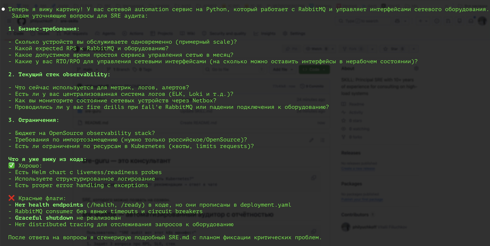

# SRE SLX — SLO, SLI и error budget

Измеримая надёжность: выбор SLI, генерация SLO-документов, политика error budget, burn rate-алерты.

```
Пользователь: "Создай SLO для payment-api, доступность 99.9%"
Скилл: SLI (доля успешных запросов) → target 99.9% → бюджет 40 минут на 28 дней
       → политика заморозки → burn rate-алерты → документ в нужном формате
```

## Что делает

1. Подбирает SLI под тип сервиса: API, пайплайн, хранилище, инфраструктура (`references/sli-guide.md`).
2. Считает бюджет в минутах и объясняет его бизнесу (`references/negotiation.md`).
3. Генерирует документ в Markdown, YAML или JSON (`references/templates/`).
4. Настраивает burn rate-алерты с двумя окнами вместо порога «SLO нарушен» (`references/burn-rate.md`).
5. Проверяет существующий SLO на типовые ошибки.

## Форматы вывода

| Формат | Для чего | Файл |
|--------|----------|------|
| `markdown` | согласование с бизнесом | `references/templates/slo.md` |
| `yaml` | GitOps, хранение в репозитории | `references/templates/slo.yaml` |
| `json` | выгрузка во внутренние системы | `references/templates/slo.json` |

YAML и JSON — **внутренняя схема проекта**, а не стандарт и не Kubernetes CRD. `kubectl apply` для неё не работает. Если у вас Grafana SLO, Sloth или OpenSLO — используйте их формат, поля переносятся один к одному.

## Структура

```
sre-slx/
├── SKILL.md
└── references/
    ├── sli-guide.md        SLI по типам сервисов + PromQL
    ├── burn-rate.md        математика, пороги, multi-window
    ├── promql.md           запросы для Prometheus/VictoriaMetrics
    ├── negotiation.md      как согласовать target
    └── templates/          slo.md, slo.yaml, slo.json
```

## Ключевые числа

| SLO | Бюджет на 28 дней |
|-----|-------------------|
| 99% | 6 ч 43 мин |
| 99.5% | 3 ч 22 мин |
| 99.9% | 40 мин |
| 99.99% | 4 мин |

Burn rate: `14.4` — 2.1% бюджета за час, `6` — 5.4% за 6 часов, `1` — 10.7% за 3 дня. Это пороги обнаружения, а не «бюджет кончится через час».

## Чего не делает

- Не настраивает инфраструктуру мониторинга — это `sre-architect`.
- Не чинит код — это `sre-guru` и `sre-auditor`.
- Не выдумывает историю: нет данных — цель ставится как гипотеза с планом замера.
- Не предлагает SaaS-сервисы SLO (Nobl9, Datadog SLO, Grafana Cloud SLO).

## Связанные скиллы

| Скилл | Когда использовать |
|-------|--------------------|
| [`sre-architect`](../sre-architect/README.md) | Архитектура observability, алертинг, PRR |
| [`sre-auditor`](../sre-auditor/README.md) | Аудит кода и конфигов с отчётом |
| [`sre-guru`](../sre-guru/README.md) | Тактический разбор проблемы |


